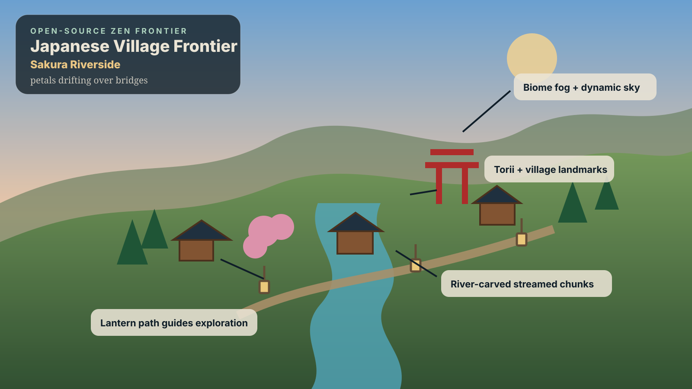
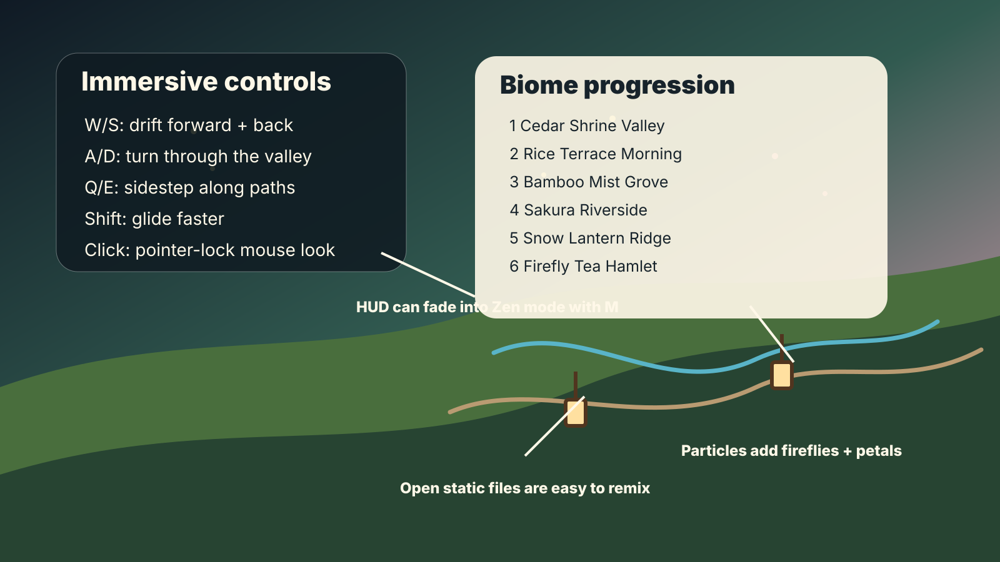

# Japanese Village Frontier

An open-source Three.js procedural world designed to feel relaxing, expansive, and immersive. Move forward through a living Japanese-inspired frontier where new environments reveal themselves gradually: shrine valleys, rice terraces, bamboo mist groves, sakura riversides, snowy lantern ridges, and firefly tea hamlets.

## What makes it feel bigger

- Seeded fractal terrain with chunk streaming around the player.
- Biome bands that change palette, fog, vegetation, ambience text, and generated landmarks as you travel.
- Procedural villages, torii gates, lantern paths, arched bridges, rivers, forests, terraces, birds, fireflies, and petals.
- Relaxation-first rendering: soft shadows, atmospheric fog, sky gradients, warm emissive paper lanterns, camera bob, and a zen HUD mode.
- Vanilla static source intended for remixing, forking, and open-source experimentation.

## Annotated screenshots





## Controls

- `W` / `S`: move forward and backward
- `A` / `D`: turn
- `Q` / `E`: drift sideways
- `Shift`: glide faster
- Click the canvas: pointer-lock mouse look
- `M`: toggle zen HUD opacity

## Run locally

```bash
npm install
npm run dev
```

Then open <http://localhost:5173> in your browser.

## Build / validate

```bash
npm run build
```

## License

Apache-2.0. See [LICENSE](./LICENSE).
